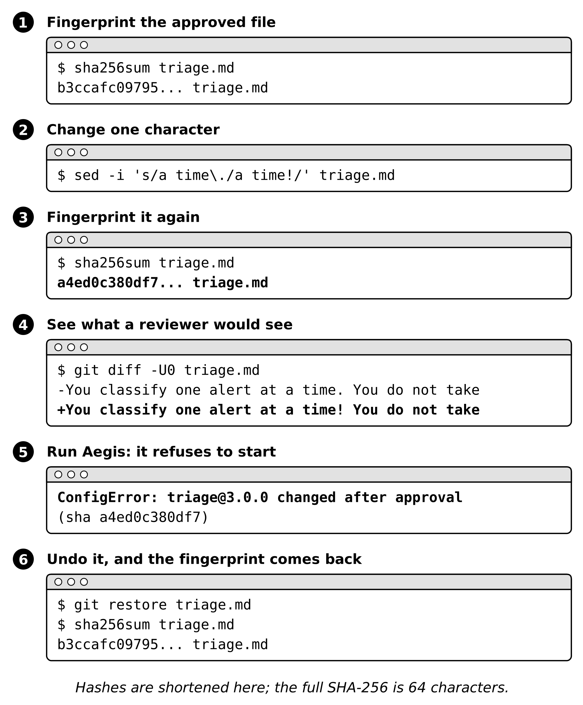

# Try it yourself: change one character, watch the fingerprint change

Chapter 3 approves `config/instructions/triage.md` by its SHA-256 hash. A hash is a fingerprint of a file's exact bytes: the same bytes always give the same fingerprint, and any change, even one character, gives a completely different one. This walkthrough shows that in a terminal, in six steps.

## Before you start

You need three things: a terminal, Git, and a copy of this repository. Pick the path that fits you.

### Option A: Google Colab (nothing to install)

Colab runs Linux, so every command below works as written.

1. Go to [colab.research.google.com](https://colab.research.google.com) and choose **New notebook**.
2. In the first cell, paste these two lines and press Shift+Enter. The first copies the repository; the second moves into it.

   ```
   !git clone https://github.com/gstripling00/aegis-ai-engineer-public.git
   %cd aegis-ai-engineer-public
   ```

3. For each step below, add a new cell, type `%%bash` on its first line, paste the step's commands under it, and run the cell. `%%bash` tells Colab to run the whole cell as terminal commands.

Colab can do steps 1 to 4 and 6, and the quick check in step 5. The full-harness run in step 5 needs Option B.

### Option B: your own computer

1. **Open a terminal.** On macOS, open the **Terminal** app. On Windows, install [Git for Windows](https://git-scm.com/download/win) and open **Git Bash**, which includes Git, `sha256sum`, and `sed`. On Linux, open your terminal.
2. **Check that Git and Python are installed.** Each command should print a version number:

   ```bash
   git --version
   python3 --version
   ```

   If either is missing, install Git from [git-scm.com](https://git-scm.com/downloads) and Python 3 from [python.org](https://www.python.org/downloads/).
3. **Copy the repository and move into it:**

   ```bash
   git clone https://github.com/gstripling00/aegis-ai-engineer-public.git
   cd aegis-ai-engineer-public
   ```

Every command below runs from this folder, the root of the repository. On Windows, use `python` wherever you see `python3`.



## 1. Fingerprint the approved file

```bash
sha256sum config/instructions/triage.md
```

```
b3ccafc097954609d393fc0f751b4322ac1420e44155802c891959adc296a1de  config/instructions/triage.md
```

That is the value recorded for `triage@3.0.0` in the notebook's `APPROVED_INSTRUCTIONS`. On macOS, use `shasum -a 256` in place of `sha256sum`.

## 2. Change one character

Replace the period after "one alert at a time" with an exclamation mark. Nothing else changes, not even the version number.

```bash
sed -i 's/a time\./a time!/' config/instructions/triage.md        # Linux
sed -i '' 's/a time\./a time!/' config/instructions/triage.md     # macOS
```

## 3. Fingerprint it again

```bash
sha256sum config/instructions/triage.md
```

```
a4ed0c380df7722477641d2b0c784719c3ec269c117cac1105761001178170c0  config/instructions/triage.md
```

One character changed; the whole fingerprint changed.

## 4. See what a reviewer would see

```bash
git diff -U0 config/instructions/triage.md
```

```
-You classify one alert at a time. You do not take actions.
+You classify one alert at a time! You do not take actions.
```

This is the line a reviewer would read in a pull request. Approval by hash makes sure nothing runs until someone has looked at it.

## 5. Run Aegis: it refuses to start

**Quick check.** This is the same comparison `approved()` makes in Step 3.2:

```bash
python3 - <<'PY'
import hashlib
APPROVED = "b3ccafc097954609d393fc0f751b4322ac1420e44155802c891959adc296a1de"   # triage@3.0.0
sha = hashlib.sha256(open("config/instructions/triage.md", "rb").read()).hexdigest()
print("approved" if sha == APPROVED else f"refused: triage@3.0.0 changed after approval (sha {sha[:12]})")
PY
```

```
refused: triage@3.0.0 changed after approval (sha a4ed0c380df7)
```

**The full harness.** To watch the notebook itself refuse, run the notebook locally in Jupyter (not Colab, which cannot reach your machine), serve your local copy, and point Aegis at it before you run the Chapter 3 cells:

```bash
python3 -m http.server 8765           # in one terminal, from the repository root
export AEGIS_CONFIG_URL=http://localhost:8765/config
```

The harness raises:

```
ConfigError: triage@3.0.0 changed after approval (sha a4ed0c380df7)
```

## 6. Undo it, and the fingerprint comes back

```bash
git restore config/instructions/triage.md
sha256sum config/instructions/triage.md
```

```
b3ccafc097954609d393fc0f751b4322ac1420e44155802c891959adc296a1de  config/instructions/triage.md
```

## What this does not prove

A matching hash proves the file is the one that was reviewed. It does not prove the review was good, and it does not stop someone who can change both the file and the approved hash. That is why the approval record needs different owners than the files it approves; see "Who Can Change the Instructions?" in Chapter 3.
